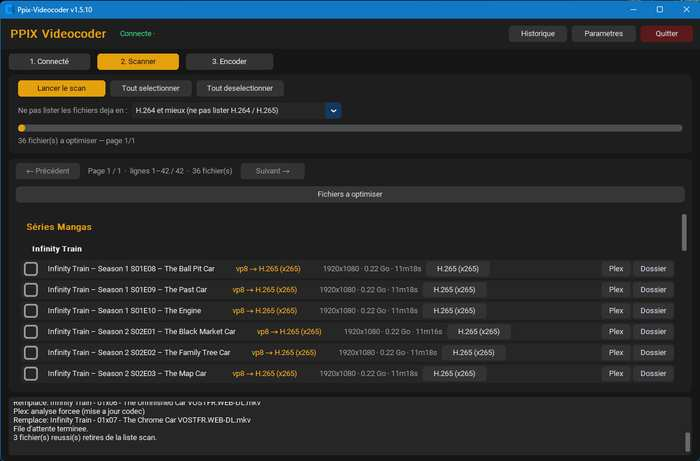
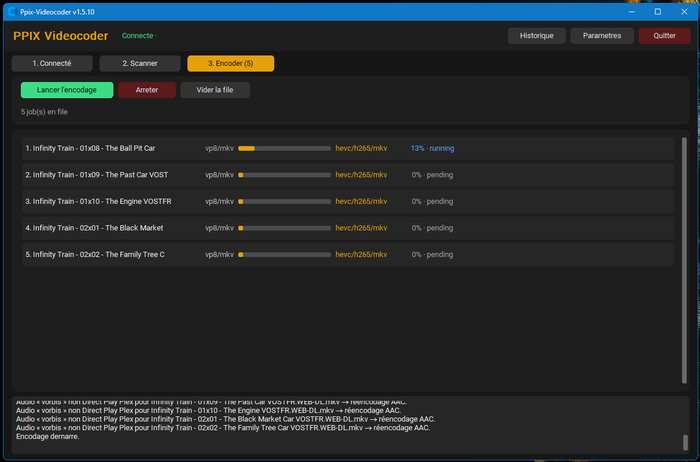
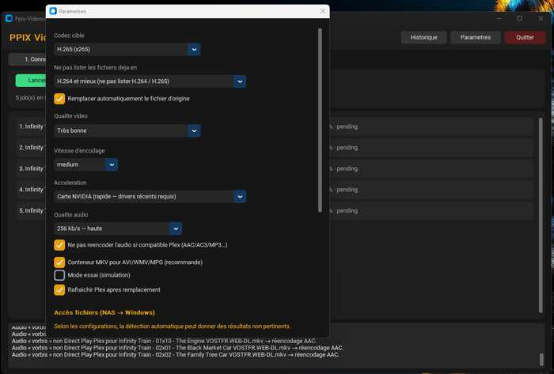

# Ppix-Videocoder (Version pré-distribuable finale)

[](https://github.com/Kahenis/Ppix-videocoder/actions/workflows/build-windows.yml)
[](https://github.com/Kahenis/Ppix-videocoder/releases/latest)

Application **Windows** autonome pour optimiser les codecs vidéo de vos bibliothèques **Plex**.
Les vieux codecs (AVI, MPEG-2, WMV…) obligent souvent Plex à transcoder en direct, ce qui charge le NAS et coupe le Direct Play. Ppix-Videocoder scanne vos bibliothèques, détecte les fichiers non optimaux, et les réencode en H.265 ou H.264 avec FFmpeg inclus — file d’attente, progression, remplacement optionnel de l’original, le tout en profitant de l’accélération matérielle de votre PC (CG Nvidia, CG AMD, CPU)

> **Version publiable : 1.6.0**  
> Téléchargement : [Releases](https://github.com/Kahenis/Ppix-videocoder/releases/latest)

---

## Aperçu

| Scanner | Encoder | Paramètres |
|:---:|:---:|:---:|
|  |  |  |

---

## Téléchargement

1. Ouvrez [la dernière release](https://github.com/Kahenis/Ppix-videocoder/releases/latest)
2. Téléchargez `Ppix-Videocoder-*-windows.zip`
3. Décompressez
4. Lancez `Ppix-Videocoder.exe`

**Rien d'autre à installer** : FFmpeg est embarqué dans l'archive.

Les réglages (token, chemins réseau, historique) sont conservés entre les versions dans :

`%USERPROFILE%\\.ppix-videocoder\\`

---

## Fonctionnalités

| Zone | Détail |
|------|--------|
| Connexion | Code PIN plex.tv/link ou token (stocké dans le Gestionnaire d'identification Windows) |
| Scan | Films + séries par pages (grandes bibliothèques 7k+), recherche, filtre par bibliothèque, arrêt possible |
| Sélection | Codecs anciens (MPEG-2, Xvid, WMV…) et, en option, H.264 trop lourds |
| Codecs | H.265 (recommandé) ou H.264 — CPU, NVIDIA, Intel QSV, AMD, repli CPU automatique |
| Pistes | Toutes les pistes audio et sous-titres conservées, 5.1 préservé, 10 bits/HDR gardés en H.265 |
| Vidéo | Désentrelacement automatique (DVD/TV), dimensions impaires corrigées |
| Conteneurs | Conservation mkv→mkv, mp4→mp4 ; AVI/WMV/MPG/TS → mkv (extension corrigée au remplacement) |
| Sécurité | Encodage dans un fichier caché, vérification (durée, pistes) avant remplacement, retour arrière en cas d'erreur, espace disque contrôlé |
| File | Validation non bloquante : Remplacer / Garder les 2 / Jeter, ordre modifiable, relance des erreurs, ETA |
| Plex | Analyse ou scan du dossier après remplacement |
| NAS | Racine réseau Windows + autodétection API + test d'accès |
| Audio seule | Case « Audio seule (TrueHD → AC3) » : liste les fichiers TrueHD, vidéo copiée sans réencodage, TrueHD remplacé par AC3 5.1 640k |
| Suivi | Pendant l'encodage : qui travaille (carte graphique et moteur NVENC/Quick Sync/AMF, ou processeur), % CPU total et de l'encodage, % GPU et de l'encodeur vidéo |
| Confort | Priorité basse, PC maintenu éveillé, arrêt du PC en fin de file (option) |

---

## Utilisation rapide

1. **1. Connexion** → Se connecter via plex.tv/link  
2. **Paramètres** → Racine réseau Windows (`\\\\IP\\Partage`) si besoin  
3. **2. Scanner** → Lancer le scan  
4. Cocher les fichiers à convertir (ajout automatique à la file)  
5. **3. Encoder** → Lancer l'encodage  

Astuce : activez le *mode essai* dans les paramètres pour une simulation sans écrire de fichiers.

---

## Nouveautés 1.6.0

Nouvelles fonctions :
- Mode « Audio seule » : conversion TrueHD → AC3 5.1 640k en quelques minutes, sans toucher à la vidéo (l'Atmos éventuel est perdu, comme pour toute conversion AC3).
- Ligne de suivi sous le fichier en cours : matériel utilisé, % CPU (total et encodage), % GPU (global et encodeur vidéo).

Corrections importantes :
- Les pistes audio supplémentaires (VO/VF) et les sous-titres n'étaient pas conservés : c'est corrigé.
- Le 5.1 était systématiquement réduit en stéréo : il est désormais conservé (stéréo en option).
- Le mode « Auto » d'accélération utilisait le CPU avec un réglage de qualité ignoré : corrigé.
- Un `film.avi` remplacé devenait un MKV nommé `.avi` : l'extension suit maintenant le vrai conteneur.
- L'original n'était plus protégé si le remplacement échouait : sauvegarde temporaire et restauration.
- Plantage de la fenêtre « Racine réseau » au premier scan : corrigé.
- Le choix H.265/H.264 par fichier n'était pas pris en compte après la coche : corrigé.
- Le mode essai retirait les fichiers de la liste comme s'ils avaient été encodés : corrigé.
- Les fichiers partiels restaient sur le NAS après une erreur ou un arrêt : ils sont supprimés.

## Avertissement

Développement personnel. Des bugs peuvent encore apparaître.  
Aucun engagement de responsabilité en cas de problème sur vos bibliothèques Plex — **faites des sauvegardes** et testez d'abord en mode essai.

---

## Développement

```text
Python 3.12 + CustomTkinter + plexapi + FFmpeg/ffprobe
Build : GitHub Actions → tests → PyInstaller (Windows)
```

Tests (FFmpeg et ffprobe dans le PATH) :

```text
pip install -r requirements.txt pytest
python -m pytest -q tests                 # le test d'interface demande un affichage
```

Déclencher un build / une release :

- **Tag** `v1.6.0` poussé sur `main` → build + release automatiques  
- Ou **Actions → Build Windows EXE → Run workflow** (case « Publish release »)

---

## Licence

Usage personnel libre.  
FFmpeg : LGPL/GPL selon la build.  
plexapi : BSD.
